# HEAL: A 4D CBCT Imaging Method in Interventional Pulmonology with Hierarchical Explicit Alignment and Residual Learning

Author: Ziheng Deng, Jun Zhao, School of BME, Shanghai Jiao Tong University

This repository presents the visualization results of HEAL: A 4D CBCT Imaging Method in Interventional Pulmonology with Hierarchical Explicit Alignment and Residual Learning. In this paper, we introduce intraprocedural 4D CBCT imaging for pulmonary interventions. From a single routine CBCT scan, without changing the acquisition protocol, our framework estimates the respiratory signal with RIDE and reconstructs phase-resolved 4D CBCT images with HEAL.

More details will be released after the paper is published.

## Demo

Here are some examples of HEAL tested on __*real clinical intraprocedural CBCT scans*__. The data were acquired with a C-arm CBCT system during ventilator-assisted breathing. Each scan covers 180° in 30 s.

*Note: All visualizations are copyright protected. Contact the author for high-resolution versions or reuse permissions.*

### Reconstruction results in axial view

The two-frame GIFs switch between the averaged image and the HEAL result to show the reduction of motion artifacts. The reference images were acquired in a separate scan with ventilation suspended at deep inspiration.

<picture><source media="(prefers-color-scheme: dark)" srcset="demo/labels/fig1-h1-dark.png"></picture>
<picture><source media="(prefers-color-scheme: dark)" srcset="demo/labels/fig1-h2-dark.png"></picture>
<picture><source media="(prefers-color-scheme: dark)" srcset="demo/labels/fig1-h3-dark.png"></picture> 
<picture><source media="(prefers-color-scheme: dark)" srcset="demo/labels/fig1-case1-dark.png"></picture>
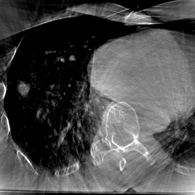
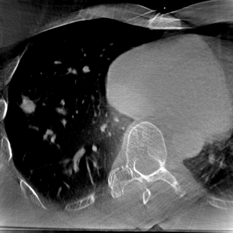
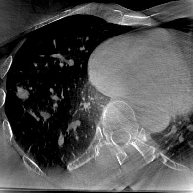 
<picture><source media="(prefers-color-scheme: dark)" srcset="demo/labels/fig1-case2-dark.png"></picture>

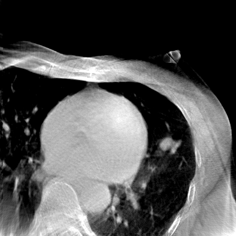
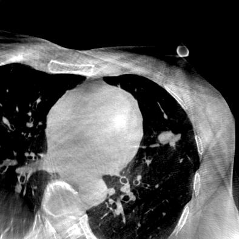 
<picture><source media="(prefers-color-scheme: dark)" srcset="demo/labels/fig1-case3-dark.png"></picture>
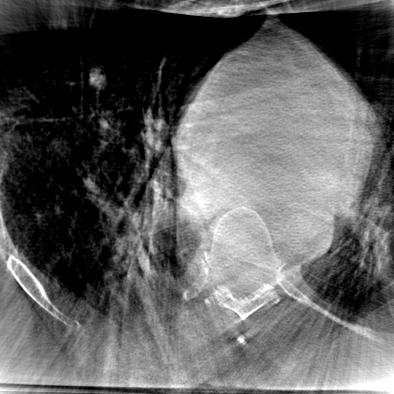
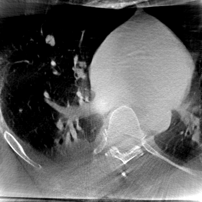

### Dynamic results in coronal view

The two-frame GIFs compare the averaged image with the HEAL result, and the dynamic images show the HEAL reconstruction over a respiratory cycle. MIP denotes maximum intensity projection.

<picture><source media="(prefers-color-scheme: dark)" srcset="demo/labels/fig2-h1-dark.png"></picture>
<picture><source media="(prefers-color-scheme: dark)" srcset="demo/labels/fig2-h2-dark.png"></picture>
<picture><source media="(prefers-color-scheme: dark)" srcset="demo/labels/fig2-h3-dark.png"></picture>
<picture><source media="(prefers-color-scheme: dark)" srcset="demo/labels/fig2-h4-dark.png"></picture> 
<picture><source media="(prefers-color-scheme: dark)" srcset="demo/labels/fig2-case1-dark.png"></picture>
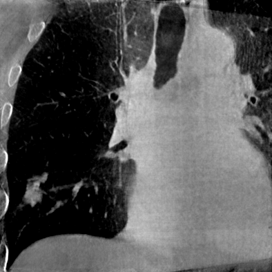
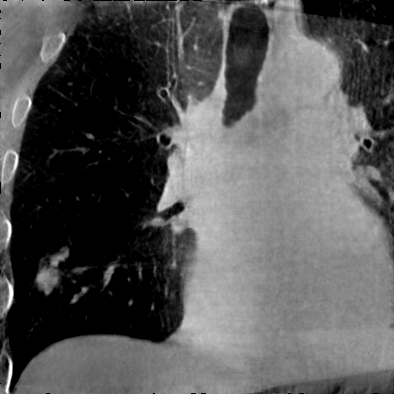

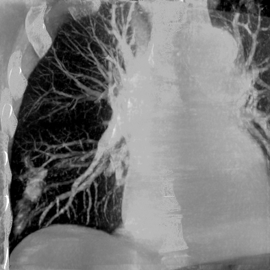 
<picture><source media="(prefers-color-scheme: dark)" srcset="demo/labels/fig2-case2-dark.png"></picture>

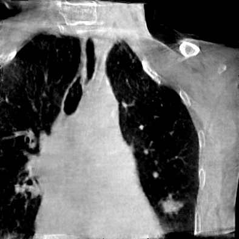
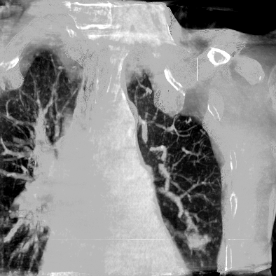
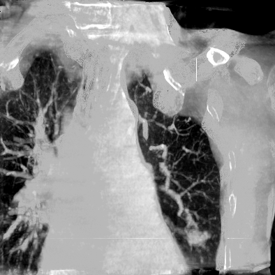 
<picture><source media="(prefers-color-scheme: dark)" srcset="demo/labels/fig2-case3-dark.png"></picture>
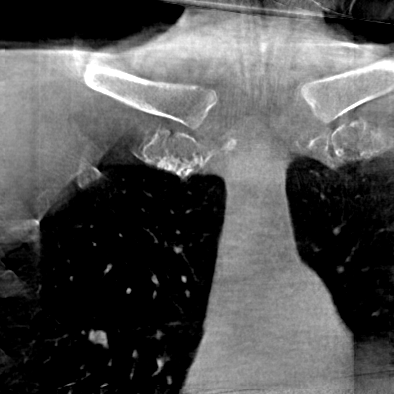
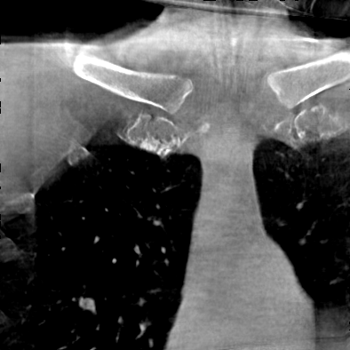
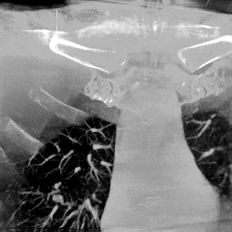
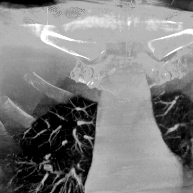

### Dynamic augmented fluoroscopy

4D CBCT may also support downstream applications such as dynamic augmented fluoroscopy. This is a conceptual demonstration, in which the red masks indicate the lesion positions on the 4D CBCT images and on the fluoroscopic projections during breathing.

<picture><source media="(prefers-color-scheme: dark)" srcset="demo/labels/fig3-h1-dark.png"></picture>
<picture><source media="(prefers-color-scheme: dark)" srcset="demo/labels/fig3-h2-dark.png"></picture> 
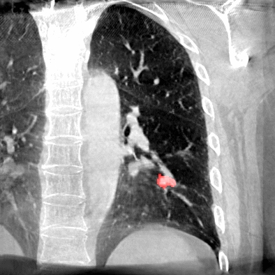
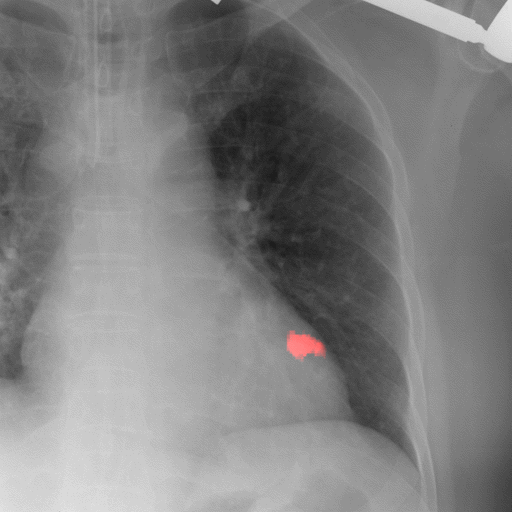

## Workflow

### Respiratory signal estimation with RIDE

RIDE (Respiratory Implicit Decomposition and Encoding) estimates the respiratory signal from CBCT projections by separating respiratory patterns from non-respiratory interference.

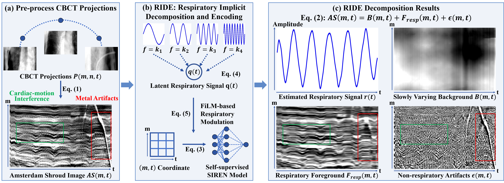

### 4D CBCT reconstruction with HEAL

HEAL first recovers major anatomical structures through explicit inter-phase alignment, and then progressively refines local details through residual learning.

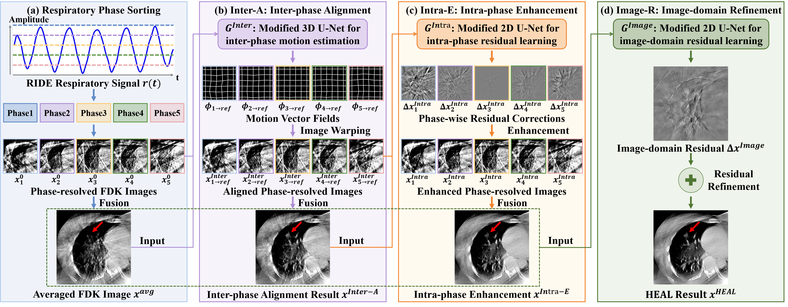

